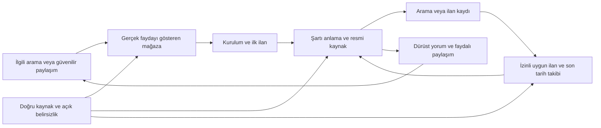

# KamuBul büyüme stratejisi ve devralma sözleşmesi

Karar tarihi: 16.10.2026. Durum: araştırmaya dayalı uygulama yönü; büyüme sonuçları henüz ölçülmedi. Kullanıcı yönü [tam metin](USER_OBJECTIVE_2026-10-16.md); kanıtlar [resmi kaynak araştırması](RESEARCH_2026-10-16.md) ve [rakip saha matrisi](COMPETITORS_2026-10-16.md). Bunlar eski 15 Ekim raporunun Pro ekranı deneyi önerisini değiştirir. Takip/heartbeat/cron kurulmaz; önceki günlük iş silindi.

## Hedefi uygulanabilir hale getirme

Son kullanıcı netleştirmesi (16 Ekim): “bizim hedefimiz birinci sırada çıkmak değil ... ilk, en iyi ve en çok indirilen uygulama ... tekrar, tekrar bir döngü ... dar kapsamlı düşünme, geniş düşün”. Hedef tüm ürün kalitesi, kullanıcı başarısı ve sürdürülebilir büyümedir; yalnız sıralama/metin işi olarak daraltılmaz. Araştırma dilleri serbest, uygulama ve mağaza Türkçe. [Uluslararası örüntüler ve kalite döngüsü](INTERNATIONAL_PATTERNS.md) aynı planın kanıt ekidir. Ana Türkçe metnin hazırlık/yayın işi SA-025, deneyler ayrı SA-007/008/009 işleridir.

Kullanıcı hedefi: en çok indirilen, aramalarda en üstte çıkan ve memnuniyet sağlayan uygulama. Kuzey yıldızı: **kullanıcının ilgili açık ilanı bulup şartını anlayarak resmi başvuru yoluna güvenle ulaşması**. Bu başarı gerçek talep, tavsiye ve elde tutma üretmelidir. “Birinci” hedef olarak korunur; Google'ın ve rakiplerin kontrolündeki sonucu teslim garantisi gibi yazma.

Beş farklı sonucu ayrı kaydet: (1) seçili sorgulardaki keşfedilebilirlik, (2) mağaza ziyaretinden Install tıklaması, (3) tamamlanmış gerçek edinim, (4) ilan görevini başarıyla tamamlama/geri dönüş, (5) sağlıklı monetizasyon. Tek metriği yükseltirken yanlış vaat, reklam baskısı veya bildirime zorlama ile diğerlerini bozma.

## Konumlandırma seçenekleri ve seçim

| Seçenek | Artı | Maliyet/risk | Karar |
|---|---|---|---|
| A — Geniş kamu haberleri/sınav araçları merkezi | Memurlar/Atama web kitlesine daha geniş içerik girişi | Haber editörlüğü, CV/sınav doğruluğu, büyük özellik kapsamı; yerleşik dağıtım ağlarıyla doğrudan yarış | İlk aşama için seçilmedi. Araştırmada hacim var ama KamuBul'un mevcut kaynağı ve çekirdek işiyle daha pahalı. |
| B — Kişiye uygun ilan + son tarih/başvuru takibi | Tekrarlanan somut ihtiyaç, rakiplerde güçlü mesaj | Bildirim/tarih/çoklu kadro doğruluğu kabulü gerekiyor; rakipler zaten sunuyor | Temel ürün omurgası. Güvenilirlik farkı örneklem ve gerçek journey ile kanıtlanır. |
| C — İlan şartlarını Türkçe Asistan ile açıklayan takip aracı | Mevcut çalışan sohbeti somut farklı faydaya çevirir; uzun resmi metindeki sürtünmeyi azaltır | AI belirsizliği, raporlama/sağlayıcı/veri açıklaması, soru kotası; her kullanıcı sohbet istemeyebilir | B omurgası üzerinde C mesajını test et. “Tek AI uygulaması” değil, kaynak bağlamıyla açıklama teklifi. |

Seçilen teklif: **“Kamu ilanını bulun. Şartlarını anlayın. Başvuru süresini takip edin.”** Son cümle bugün tarih/rozet/kayıt düzeyinde; otomatik hatırlatma ancak SA-015'in yayımlanmış kabulünden sonra pazarlanır. AI-first kreatif RA-1 hipotezidir; ilan-first'i peşinen yenmiş sayma.

## Hedef kullanıcılar ve kelime niyet haritası

Arama hacimleri/rekabet puanları **UNKNOWN**. Aşağıdaki öncelik ürün uyumu ve 16 Ekim saha örneklerine dayanır; ücretli ASO aracından gelmez. KPSS/ÖSYM/kurum adı başlık ve kısa metinde C-060 nedeniyle yok; uzun metindeki betimleyici kullanım ve bağımsızlık uyarısı korunur.

| Niyet / kullanıcı işi | Aday kelime ailesi | Uygun yüzey | Kanıt ve ilk aksiyon |
|---|---|---|---|
| Genel kamu işi arama | kamu ilanları, kamu iş ilanları, kamu personel alımı, memur alımı | Odaklı ana başlık/kısa açıklama; tam açıklamanın doğal giriş cümlesi | Tek seferlik üç sorguda rakipler gözlendi; KamuBul birinde10., ikisinde dönen sette yok. Console TR ziyaret/tıklama kırılımı olmadan hacim lideri seçme. |
| Kamu işçisi/sözleşmeli | kamu işçi alımı, sözleşmeli personel, belediye personel alımı | Ana uzun açıklama + ileride belediye özel listeleme | Gerçek filtre/ilan ekranı kullan; özel sektör kapsamı veya doğrudan başvuru iddiası yok. |
| Akademik | akademik ilanlar, araştırma görevlisi ilanı, öğretim görevlisi kadrosu | Kaynak kapsamı doğrulanmış özel listeleme; özgün web rehberi | Rakip web/Play kapsamı çelişkili. Tüm üniversiteler iddiası yok. SA-009 önce dar kapsam gösterir. |
| Şart uygunluğu | bana uygun kamu ilanları, eğitim/yaş/puan şartı, KPSS'siz personel alımı | Asistan görseli, uzun metin, yerinde ürün açıklaması | İlan bağlamı + bilinmeyen koşul örneği; puan girmeyince sınavsızlık veya kesin uygunluk varsayma. |
| Zaman/hatırlatma | son başvuru tarihi, kaydedilen ilan, yeni ilan bildirimi | Gerçek tarih ekranı; bildirim ekranı kabul sonrası | Otomatik son tarih uyarısı bugün hedef özellik; mağazada çalışırmış gibi yazma. |
| Marka | KamuBul, Kamu Bul | Başlık/ikon/site/GitHub/destek tutarlılığı | Yeni kullanıcıya telaffuz/amaç net; geliştirici adını kelime listesine çevirme. |

Uygulama başlığını her gün değiştirme. İlk öneri mevcut markalı başlığı korumak, kategori ihtiyacını kısa açıklamada anlaşılır kılmak. Console deneyi başlık testini desteklemiyor; başlık değişikliğini açıklama A/B sonucu gibi raporlama. Yeni kelime ailesi ancak gerçek ürün uyumu ve sorgu verisiyle öncelik kazanır.

## Büyüme mimarisi

| Katman | Mevcut altyapıdan kullan | Ölçülecek iş / kabul kapısı | İş sahibi |
|---|---|---|---|
| Keşif | Türkçe metadata, İş kategorisi, mevcut Site | TR uygun cihaz/public yayın; ilgili sorgu ziyaretleri; marka/genel kaynak ayrımı | SA-021/009/011 |
| Mağaza güveni | Gerçek yüksek çözünürlüklü ekranlar, kaynak/bağımsızlık | Yanlış100/30 ve Pro satış görseli yok; metin/kod/public eşleşmesi; 3 saniyede fayda anlaşılması saha hipotezi | SA-021, STORE_COPY |
| İlk fayda | Mevcut liste/arama/filtre; izin/onboarding atlanabilir | Hesap/ücret/bildirim izni zorlamadan ilk açık ilan ve resmi kaynak; hata/offline'da sonraki adım | SA-001/002/005 |
| Şart açıklama | Tek motor/şema, alıntılı mekanik ayıklama, ilan bağlamlı sohbet | Eksik koşul unknown; pozisyonlar karışmaz; AI raporlama; kaynak revizyonu belli | SA-003/004/017 + yeni AI bildirimi |
| Geri dönüş | SavedSearch + FCM + yerel favori; native calendar altyapısı | Doğru yeni ilan, tekrar yok, tercih/izin değişimi; kesin tarihli yerel hatırlatma | SA-015/005 |
| Başvuru düzeni | Cihazda kayıtlı ilan modeli | Yerel durum/not; resmi başvuru gönderildiği iddiası yok; silme/migration güvenliği | SA-018 |
| Gelir | Mevcut napp_pro/ads,58,99aylık10/50 | Ücretsiz temel ilan; güvenilir Play entitlement; iptal/restore/pending; reklam okuma/başvuruyu kesmez | SA-016/005 |

Yeni hesap sistemi, yeni AI sıralama servisi, yeni ücretli altyapı veya genel sınav koçluğu gerekmiyor. Kaynak güveni temel: schemaVersion2/taxonomyVersion1, tip/aralık/allowlist ve alan kaynağı; mekanik önce, eksikse alıntı doğrulamalı AI. Bu kontroller precision kanıtı değildir. Kaynak başına en az50 etiketli alan örneğiyle precision≥0,95 ve ayrı recall/kapsam; yanlış “uygun” en kritik hata, unknown ayrı sınıf. Resmi metin/revizyon/çıkarım kökeni kalite örneğinde birlikte okunur. Kaynak erişim engeli sıralama metniyle çözülemez.

## Metin ve görsel uygulama sözleşmesi

Tam adaylar [STORE_COPY.md](STORE_COPY.md) içinde. Ana sayfa, özel listeleme, web, uygulama ve ürün hakkı aynı faydayı söylemeli. Public eski8 görsel/yeni aday7 ayrımı korunur. API commit = Google onayı/public yayın değildir. Kullanıcının mağaza görseli kuralı: **satın al, Pro'ya geç, deneme veya fiyat promosyonu gösterme**. Tam açıklamada ücretsiz/abonelik koşulları şeffafça yer alır.

İlk set: ilan bulma → seçili ilan için Asistan sonucu → kadro/şart kanıtı → kişisel filtre → kaydet/çevrimdışı → tarih → tema/yazı. AI-first varyant aynı kaliteli görsellerin ilk ikisini değiştirir; farklı ilan, yeni metin, ikon ve görsel sırası aynı anda değişmez. Henüz çalışan yeni bildirim/başvuru-not özelliği yoksa yedinci ekranla değiştirme; yayın kabulü sonrası ayrı araştırma.

Tasarım ölçütü: aynı mavi marka, tek görselde tek iş, gerçek UI baskın, 1080×1920 çıktı, küçük önizlemede okunur ana başlık; metin yoğunluğu düşük, gerekli başlık≤%20. Düğme/sonuç kesilmez; resmi kaynağın yanlış/tekrarlı yer metni vitrine taşınmaz. Altmetin görseldeki eylem/sonucu açıklar. Zaman aşımını azaltmak için uzun vadede tarihe bağlı satış başlığı kullanma; gerçek ilanın tarihi değiştirilmez veya sahte gelecek ilan üretilmez.

## Ölçüm ve deney tasarımı — otomatik takip kurulmadan

| Aşama | Manuel veri ve tanım | Karar |
|---|---|---|
| 0 Public tutarlılık | Paket/tr-TR/üretim, title-short-full/sıra/hash, Publishing overview inceleme durumu | Public yanlış vaadi düzeltmek deney değildir; yanlış kontrolü bilinçli trafiğe tutma. |
| 1 Baseline | Son28gün visitors/uniqueInstallclicks/InstallCTR + gerçek user acquisitions; TR/tr-TR/listing/kaynak/yeni kullanıcının filtreleri | Payda yetersizse UNKNOWN; 5+public toplam indirmeden gün/kanal talebi çıkarma. |
| 2 Tek kreatif hipotezi | RA-1: ilan-first ↔ AI-first; kontrol+1varyant; Console MDE/güven/dağılım; en az tam hafta ve yeterli veri | Kazanma: Console destekli olumlu aralık ve tutarlı scope; draw/more data needed durumunda aynı sonucu açık yaz. |
| 3 Kısa açıklama | A kategori+Asistan ↔ B kişisel kayıt faydası; görsel seti/ikon sabit | Tıklama kazanımı gerçek edinim/elde tutmayla birlikte incelenir; zaman serisinden nedensellik iddiası yok. |
| 4 Niyet özel sayfa | Önce en fazla akademik/belediye; Console kelime demeti ve gerçek kapsam | Aynı trafik/dönem; toplam ziyaret düşükken parçalayarak örneklemi tüketme. |
| 5 Ürün yararı | İlk ilan açma/resmi kaynağa ulaşma, kriter kaydı/izin, uygulamaya geri dönüş;5gönüllü test | Şu an yeni analytics SDK veya kişisel profil export'u ekleme; mevcut Console ve elle testle başlayıp gerçek boşluğu belirle. |
| 6 Sağlık/gelir | Vitals, user loss/DAU-MAU, iptal/restore/cart conversion; kaynak hata/coverage | Reklam/ödeme/source kusuru büyükse dağıtımı ölçeklemeden gider; sıralama katsayısı diye yorumlama. |

Rapor metrik adı/sürüm/cohort/pay/payda/export kaynağını taşımalı. InstallCTR = intent, gerçekleşen kurulum ayrı. Kategori sorguları Explore'a girebildiği için Search-only karşılaştırma eksik olabilir. Daily yüzdelerin basit ortalaması yerine aynı kapsamın toplam pay/paydasını kullan. A/B testleri gerçek trafik gerektirir; keyfi %artış, dönüşüm veya indirme hedefi icat etme.

## Dağıtım ve web SEO

1. Mevcut ücretsiz public Site'nin başlık, açıklama, canonical,robots,sitemap temeli var. Yetkili Search Console URL Inspection olmadan indeks/bot erişimi tamamlandı deme; host bot korumasını ve mobil render'ı kontrol et. MobileApplication şeması rich result şartlarını tam karşılamıyor; sahte rating ekleme.
2. İki özgün rehber adayı: “Kamu ilanında yaş/eğitim/puan şartını nasıl okuyabilirim?” ve “Kamu ilanında son başvuru ve resmi başvuru adresini nasıl kontrol ederim?” Gerçek anonim resmi örnek+kaynak+güncelleme tarihi+Asistan sınırı+Play bağlantısı. Her şehir için aynı metni çoğaltma; genel tek sayfalık tanıtımı JobPosting diye işaretleme.
3. Organik dağıtım hipotezi: bölüm/mezun topluluklarına faydalı ilan okuma rehberi ve gerçek ürün örneği; yalnız topluluk kuralları/izniyle paylaşım. Bu oturum hiçbir topluluğa mesaj göndermez. GitHub README/Site/Play marka-kaynak-destek bağlantıları tutarlı olabilir; sponsorlu backlink/yorum satın alma yok.
4. Paylaşım gelecekte kanonik resmi ilan bağlantısını ve uygulamanın bağımsız olduğunu taşımalı; kişisel puan/profil/kurulum secret'ı içermez. App Links/kurulum sonrası rota ancak gerçek ürün ihtiyacı ve güvenli kimlikle doğrulanır; Engage SDK için kategori erişimi araştırılmadan yeni bağımlılık yok.
5. Ücretli reklam kampanyası bu aşamada başlatılmaz. Önce doğru public aday, ilk fayda, kaynak kalitesi ve entitlement; bütçe/edinim maliyeti/retention kanıtı geldiğinde ayrı karar. Kullanıcının genel izni sınırsız ücretli bütçe değildir.

## Ürün özellik sırası ve gelir kararı

- **Önce güven/uygunluk:** public yanlış Pro100/30 ve satış görseli, AI in-app report, kaynak alanları/abonelik hakkı. Sonra reklam ve bildirim yaşam döngüsü kanıtı. Bunlar yeni özellik sayısını artırmadan kaybı azaltır.
- **Sonra çekirdek eşdeğerlik:** SA-017 çoklu kadro görünümü, SA-015 son tarih hatırlatma, SA-018 başvuru notu/durum. SELLSOFT/Kamu Kadro/Atama beklentisiyle bağlı; yayın öncesi pazarlama yok.
- **Sonra farklılaşma kalitesi:** Asistan resmi metni açıp koşulun neden uyduğu/uyuşmadığı/bilinmediğini anlaşılır anlatır; soru kotası veya “AI” etiketi yerine başarı örneği göster. Sistem, kişinin işe alınmasını/uygunluğunu kesin karar olarak vermez.
- **Daha sonra talep kanıtına bağlı genişleme:** alan/belge/ehliyet gibi eksik şart türleri veya paylaşım; önce kaynak/parity sözleşmesini kur, yanlış kesin eşleşmeyi azaltıyor mu test et. Sınav/CV/haber/puan hesaplama sırf rakipte var diye eklenmez.
- **Fiyat:**58,99TL aylık korunur. iOS fiyatı/tek yorumla ucuzlatma/yıllık plan ekleme yok. Ücretsiz gerçek değer görüldükten sonra reklamsız ve50soru günlük faydası anlatılır; kullanıcı verisi eksikse churn/ARPU/CAC uydurma. Teknik Play doğrulaması olmadan gelir optimizasyonu eksik.

## Devir: sıradaki ajan ne yapacak?

1. AGENTS → Store Automation SKILL → boot → LOAD. Tam kullanıcı hedefini oku; bu stratejiyi değil kişisel hafızayı esas alarak hedefi daraltma. Sıralama sonucu tamamlandı sayılmaz.
2. Çalışma ağacındaki SA-017 kod/test/golden ve eski plan/site değişikliklerini koru. `tool/brand/store_frames.py` devralınan diff'i var; reset/clean/stash yok. Yeni araştırma belgeleri Git'te; ücretli servis açılmadı, app binary yayımlanmadı.
3. İlk uygulanacak iş **SA-021**: Publishing overview/readback ile public eski8 sebebini belirle; yeni güncel7 medya/adayı doğrula, yanlış Pro görseli çıkar. Belirsiz upload'ı tekrarlama. Kullanıcı yayın hazırlığını yetkilendirdi; hesap/araç eksikliği gerçek kanıtla yazılır.
4. Yeni P1 AI raporlama görevini net sözleşmeyle hazırla; mevcut güvenli kurulum doğrulamasını kullan, kullanıcı rızası olmadan profil/tüm sohbeti rapora gönderme. Sonra SA-016/003/004/005 kalite kapıları ve SA-017/015/018 çekirdek işleri.
5. SA-011 yetkili Console baseline'ını tek seferlik al; erişim yoksa ölçüm UNKNOWN. SA-007/008/009 yalnız doğru public kontrol ve yeterli trafikten sonra. Hiçbir heartbeat/cron/takip işi kurma.
6. Her biten iş kaynak/test/cihaz/remote türüne uygun kanıt taşır. Önceki204pass/2goldenfail gerçek ödeme/reklam/FCM kanıtı değil. En son adayın build/test/lint, emülatör journeys, politika, metadata/binary readback ve public kabulü tamamlanmalı; açıklar varken genel hedefi COMPLETE yapma.
